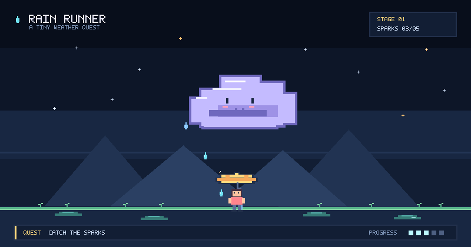

# 👋 Hi, I'm Wykernz

🎓 **BS Computer Science Student** · Learning Frontend, Backend, Mobile Programming  
📍 Philippines

I'm currently learning JavaScript, Python, and Java. Building small projects to sharpen my fundamentals — one concept at a time.

---

  

  <em>Quest: Rainbow Valley · Looping pixel-art rain scene</em>

  
  

## 📊 GitHub Stats

  
  

---

## 📫 Contact

  

  Always learning. Always building. 🚀

